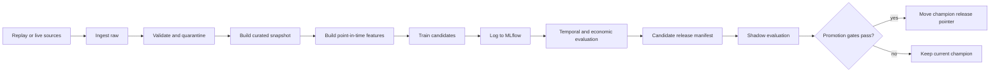
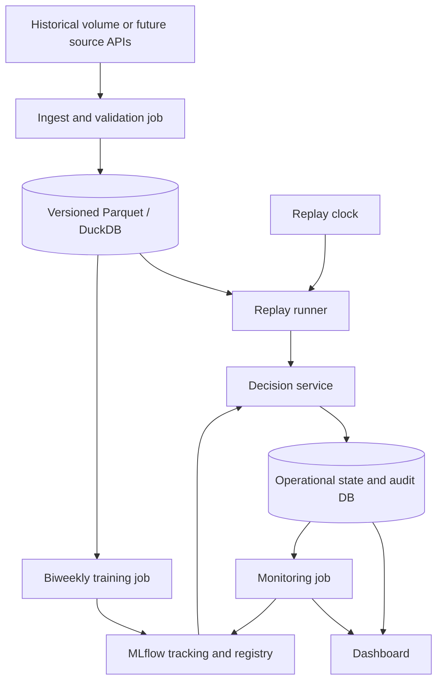

# Техническая архитектура Energy Optimization

> **Статус на 19 ноября 2026:** ML-сервис развёрнут на одной VM Yandex Cloud.
> Docker Compose запускает FastAPI blue/green, один worker, MLflow и Nginx;
> данные и SQLite хранятся на mounted volume. Проверен GitLab CI/CD, включена
> ежедневная systemd-очистка. [Публичный дашборд](http://81.26.188.18:8080)
> считает прогнозы и MPC на исторических данных по реальным часам Берлина.
> Команды и границы реализации: [`deployment.md`](deployment.md) и
> [`gitlab.md`](gitlab.md). Непрерывный shadow, автоматический promotion,
> Postgres и k3s остаются возможными расширениями; нижеследующие проектные
> варианты не означают, что все они используются в текущем деплое.

## 1. Граница реализованного и планируемого

| Область | Статус | Что входит |
|---|---|---|
| Данные и point-in-time контракты | Реализовано | Parquet/DuckDB, `valid_time_utc`, `available_at_utc`, feature views и manifests |
| Обучение и эксперименты | Реализовано | packaged training applications, temporal splits, MLflow logging и опциональная регистрация моделей |
| Прогнозирование | Реализовано offline | day-ahead PV, day-ahead price, MPC PV correction, intraday price/spread, quantiles и scenarios |
| Оптимизация | Реализовано offline | deterministic MILP, MPC, SAA/CVaR, общий settlement ledger и Oracle/Rule-based границы |
| Historical replay service | Развёрнут | часы Europe/Berlin, gated historical provider, новый inference/MILP, SQLite state и ограниченный по retention audit |
| Serving и dashboard | Развёрнут | read-only dashboard/API, polling и защищённое управление replay |
| Retraining и promotion | Частично реализовано | biweekly virtual-time candidates, MLflow, forecast/economic gates, manual promotion/rollback; continuous shadow далее |
| Monitoring и deployment | Развёрнут и проверен | data/model/decision metrics, Docker Compose, Nginx blue/green, GitLab CI/CD, Registry и systemd maintenance |

Реализованный сервис прогоняет application path по историческим входным
данным так, как будто они поступают сейчас. Семимесячный demo period делится
на март--июнь 2025 года как однократную псевдоисторию и июль--сентябрь 2025
года как повторяемый loop. В ускоренном режиме один симулируемый час может
занимать несколько секунд; в демонстрационном daily режиме один исторический
день может соответствовать одному реальному дню.

## 2. Основное архитектурное решение

Проект остаётся **модульным монолитом**:

- один Python package и один репозиторий;
- один application Docker image, запускаемый в разных режимах;
- четыре независимо обучаемых estimator artifacts;
- один согласованный forecasting-and-decision workflow;
- MLflow как источник истины для training runs и model artifacts;
- mounted storage на сервере для исторических данных, runtime state и audit logs.

Четыре deployable-прогнозные задачи:

1. `energy-da-pv` — day-ahead PV;
2. `energy-da-price` — day-ahead price;
3. `energy-mpc-pv` — residual correction для MPC PV;
4. `energy-intraday-price` — intraday price/spread.

Вероятностные marginal models и scenario generators остаются частью общего
forecasting workflow. Они не становятся отдельными сетевыми сервисами.
Модели используют общие временные контракты, запускаются в одном decision
path и не требуют независимого масштабирования или разных SLA. Четыре
model-specific API добавили бы service discovery, сетевые ошибки и несколько
deployment lifecycles без практической пользы для учебного проекта.

## 3. Компоненты целевого контура

Один image запускается в нескольких process modes:

| Process | Назначение |
|---|---|
| `decision-api` | Загружает активный model release и рассчитывает day-ahead/MPC решения |
| `replay-runner` | Двигает виртуальные часы, раскрывает данные и вызывает decision workflow |
| `training-job` | Ingestion, validation, feature build, retraining и candidate evaluation раз в две недели |
| `monitoring-job` | Считает data, model и decision metrics после появления фактов |
| `dashboard` | Показывает текущее состояние replay, прогнозы, решения, качество и audit trail |
| `mlflow-server` | Хранит runs, model artifacts и registry metadata |

`training-job` и `monitoring-job` являются периодическими batch commands, а
не постоянно работающими HTTP-микросервисами. Для V1 их запускает cron-like
scheduler. ClearML может быть добавлен как orchestration adapter, но не нужен
для доказательства самого lifecycle и не должен конкурировать с MLflow как
model registry.

## 4. Данные и replay clock

### 4.1. Слои данных

```text
data/
  raw/          # неизменяемые ответы источников
  processed/    # нормализованные таблицы одного домена
  curated/      # общий point-in-time индекс и согласованные факты
  features/     # отдельные feature views четырёх задач
  metadata/     # manifests, quality reports, schemas и checksums
artifacts/
  experiments/  # offline evaluation outputs
```

На сервере данные находятся вне Docker image и подключаются как volume:

```text
/srv/energy/
  data/               # raw, processed, curated и feature datasets
  mlflow/artifacts/   # неизменяемые model artifacts
  state/              # virtual clock, active release и operational state
  audit/              # forecasts, decisions, realised outcomes и metrics
```

Serving processes получают `data/` и MLflow artifacts read-only. Ingestion и
training jobs пишут новые versioned paths, сначала во временный каталог, а
затем публикуют их atomic rename. Активный процесс никогда не читает частично
записанный dataset или model artifact.

### 4.2. Временные поля

Каждая нормализованная запись различает:

| Поле | Смысл |
|---|---|
| `valid_time_utc` | Период, к которому относится значение |
| `available_at_utc` | Момент, когда значение разрешено использовать системе |
| `issued_at_utc` | Время выпуска прогноза, если применимо |
| `ingested_at_utc` | Время загрузки в хранилище |
| `source` | Поставщик и набор данных |
| `quality_status` | Результат проверки записи |

Основная защита от утечки:

$$
\mathrm{available\_at\_utc} \le \mathrm{as\_of\_utc}.
$$

Внутренний индекс хранится в UTC. Границы рыночного дня и рабочего окна
вычисляются в `Europe/Berlin` с явной обработкой DST.

### 4.3. DataProvider

Модели и оптимизатор не читают файлы напрямую:

```python
class DataProvider(Protocol):
    def get_day_ahead_context(
        self,
        as_of: datetime,
        delivery_day: date,
    ) -> DayAheadContext: ...

    def get_mpc_context(
        self,
        as_of: datetime,
        horizon_end: datetime,
    ) -> MpcContext: ...

    def get_realized_interval(
        self,
        start: datetime,
        end: datetime,
    ) -> RealizedData: ...
```

Реализованный `HistoricalDataProvider` становится основой
`ReplayDataProvider`: будущие строки физически присутствуют на сервере, но
скрыты виртуальным `as_of`. Будущие adapters используют те же контракты:

- `WeatherApiAdapter`;
- `DayAheadMarketApiAdapter`;
- `IntradayMarketApiAdapter`;
- `TelemetryApiAdapter`.

В replay-режиме не нужно повторно скачивать прошлые данные из интернета на
каждом training cycle. Исторический raw layer уже неизменяемо сохранён, а
виртуальные часы управляют тем, какая его часть доступна. Live adapters
понадобятся только при переходе к реальным внешним источникам.

## 5. Decision workflows

### 5.1. Day-ahead

```text
DayAheadContext at D-1 cutoff
  -> point-in-time features
  -> PV + price forecasts
  -> optional quantiles/scenarios
  -> day-ahead optimizer
  -> fixed market position + initial production/battery plan
  -> decision audit record
```

### 5.2. MPC

```text
MpcContext after the latest completed hour
  -> reveal only newly available facts
  -> remaining PV + intraday price forecasts
  -> optimize the full remaining horizon
  -> execute only the nearest action
  -> update SoC and remaining production
  -> decision audit record
```

### 5.3. Historical stream simulation

Первоначальный release обучается только на 2024 году. Для демонстрации
используются семь последовательных месяцев 2025 года:

| Период | Роль | Поведение |
|---|---|---|
| 1 марта -- 30 июня | Псевдоистория | Проходится один раз; каждые 14 дней выполняются retraining/evaluation и сохраняются data/model quality metrics |
| 1 июля -- 30 сентября | Operational loop | Прогнозы, MPC, monitoring и biweekly retraining действительно пересчитываются; после сентября период начинается заново |

Январь--февраль остаются частью offline evaluation и могут использоваться для
проверки реализации, но не входят в публичную семимесячную timeline
dashboard. Выбор Q3 для loop даёт цельный трёхмесячный operational segment и
использует уже существующие July--September experiment artifacts.

Внутри каждого delivery day:

1. D-1: day-ahead snapshot, forecasts и nomination;
2. 06:00--21:00: почасовое раскрытие фактов и MPC replanning;
3. после дня: settlement, model-quality metrics и Oracle diagnostics;
4. каждые 14 симулируемых дней: ingest/feature/train/evaluate pipeline.

После однократного прохода псевдоистории система сохраняет immutable
`loop_start_checkpoint` на 1 июля. Он содержит:

- champion model release на границе июня/июля;
- virtual clock и deterministic random seeds;
- SoC и новый daily operational state;
- monitoring reference windows и data-quality baselines;
- scheduler counters и последнюю допустимую дату labels;
- hashes используемых datasets и feature contracts.

Когда clock достигает 30 сентября 21:00, создаётся новый `cycle_id`, а
operational state восстанавливается из `loop_start_checkpoint`. Модели,
обученные внутри предыдущего July--September cycle, не переносятся в новый
cycle: иначе система училась бы на повторно показанных данных и результат
перестал бы быть воспроизводимым. Audit history может сохраняться между
циклами для сравнения, но не входит в training или monitoring windows нового
цикла.

Повторный retraining действительно запускает pipeline. Idempotency key
содержит dataset hash, feature version, train cutoff и random seed; если
получается тот же model artifact, MLflow run нового `cycle_id` может ссылаться
на уже существующий immutable artifact вместо создания бесконечных копий.

Dashboard показывает четыре месяца псевдоистории слева как фиксированный
baseline и текущий трёхмесячный cycle справа. Границы retraining и model
release transitions отмечаются на графиках data quality, rolling forecast
metrics и decision quality.

Один и тот же application workflow используется для ускоренного replay и
будущего online path. Различаются только clock и DataProvider.

## 6. Forecast contract и согласованный model release

Общий выход estimator:

```python
class ForecastFrame:
    as_of: datetime
    target_times: list[datetime]
    point: list[float]
    quantiles: dict[float, list[float]] | None
    scenarios: list[list[float]] | None
    model_name: str
    model_version: str
    feature_version: str
    data_snapshot_id: str
```

Четыре модели могут иметь совместимые зависимости. Например, MPC residual
model ожидает прогноз конкретной day-ahead PV head model. Поэтому promotion
четырёх независимых MLflow aliases не гарантирует атомарно совместимый набор.

Поверх отдельных MLflow model versions вводится **model release manifest**:

```json
{
  "release_id": "energy-release-2025-03-14-r1",
  "created_at_utc": "2025-03-14T23:00:00Z",
  "data_snapshot_id": "replay-through-2025-03-13",
  "feature_contract_version": "energy-features-v1",
  "models": {
    "day_ahead_pv": "energy-da-pv/12",
    "day_ahead_price": "energy-da-price/8",
    "mpc_pv": "energy-mpc-pv/10",
    "intraday_price": "energy-intraday-price/7"
  }
}
```

Release может переиспользовать предыдущую version модели, если конкретная
задача не прошла promotion gate. Decision service загружает и валидирует весь
release, затем атомарно меняет in-memory pointer. Частичная замена набора
запрещена.

## 7. Retraining pipeline раз в две недели

Для каждого scheduled run фиксируются `as_of`, `train_end`, label delay,
source checksums и feature version. Pipeline идемпотентен: повтор с теми же
параметрами создаёт тот же logical dataset или безопасно переиспользует его.



Candidate gates:

1. data-quality checks прошли, quarantined rows явно учтены;
2. input/output signatures совместимы с feature contract;
3. forecast metric не хуже configured tolerance относительно champion;
4. candidate побеждает простую persistence/baseline model;
5. probabilistic forecasts проходят coverage/calibration gates;
6. короткий decision replay не ухудшает realised cost сверх tolerance;
7. physical constraints и solver audit проходят полностью.

На первом этапе promotion подтверждается вручную. Автоматический promotion
включается только после того, как replay докажет устойчивость gates на всём
2025 периоде.

## 8. Как переключать модели и контейнеры

### 8.1. Основные стратегии

| Стратегия | Механизм | Плюсы | Ограничения здесь |
|---|---|---|---|
| Blue/green | Два полных application stacks; proxy переключает весь трафик | Мгновенный switch и простой rollback | Удваивает ресурсы; избыточен для каждой model version |
| Rolling update | Реплики заменяются по одной | Экономнее blue/green, стандартен в orchestrators | Нужны минимум две реплики; не сравнивает качество моделей |
| Canary | Candidate получает малую долю реального трафика | Ограничивает blast radius | Мало decision traffic и labels приходят с задержкой |
| Shadow | Candidate получает копию входов, но его решение не исполняется | Безопасное online-сравнение на одинаковых данных | Требует двойного inference и отложенной оценки |
| A/B test | Разные пользователи получают разные политики | Полезен для продуктовых эффектов | Не подходит для одного физического energy system |
| Rollback | Возврат к предыдущему release/container | Быстро восстанавливает стабильность | Это операция восстановления, а не отдельная rollout strategy |

### 8.2. Выбор для проекта

**Обновление моделей:** champion + candidate shadow.

- champion release формирует исполняемое решение;
- candidate release получает тот же `DayAheadContext`/`MpcContext`;
- candidate outputs записываются, но не меняют production/MPC action;
- после раскрытия labels monitoring сравнивает оба release;
- promotion атомарно меняет release pointer;
- rollback возвращает pointer на предыдущий manifest.

Для этого не требуются два постоянно работающих ML-сервиса. Один service
может держать два model slots, а shadow inference выполнять асинхронно. Если
памяти недостаточно, отдельный `shadow-worker` читает те же immutable inputs.

**Обновление application code:** blue/green для портфолио-демонстрации или
rolling update при наличии orchestrator. Два контейнера `energy-blue` и
`energy-green` стоят за Caddy/Nginx/Traefik. Новый container проходит health
и smoke replay, после чего proxy переключает endpoint. Это отделяет rollout
кода от promotion моделей.

## 9. Monitoring

Monitoring разделён на четыре слоя. Один общий статус «зелёный/красный» не
заменяет исходные метрики и audit rows.

### 9.1. Data quality

Проверки выполняются по source и feature group:

- freshness и задержка относительно ожидаемого расписания;
- completeness, пропуски и длина непрерывных gaps;
- schema, dtype, units и обязательные поля;
- duplicates, monotonic timestamps и DST cardinality;
- `available_at <= as_of` и отсутствие target leakage;
- physical/range checks: PV неотрицателен, SoC в пределах, отрицательные
  market prices разрешены и не считаются ошибкой;
- all-zero PV days и рассогласование профилей как отдельные outage signals;
- distribution drift: PSI/Wasserstein для основных numeric features и
  missingness drift относительно training baseline.

Невалидные строки не исправляются молча. Они получают `quality_status`,
попадают в quarantine/audit и включают degraded-mode policy.

### 9.2. Model quality

Метрики считаются после появления labels на rolling 14- и 28-дневных окнах:

- PV/price point models: MAE, RMSE, bias и нормализованные ошибки;
- day-ahead price: daily Spearman как качество формы кривой;
- MPC correction: MAE/RMSE по lead hour;
- quantiles/scenarios: pinball loss, CRPS, interval coverage, width и
  calibration error;
- residual drift и доля случаев, когда champion проигрывает persistence.

Dashboard показывает training/reference metric, текущую rolling metric,
expected band из frozen 2025 evaluation и model release transitions. Одна
training metric не является alert threshold: сезонность требует сравнения с
тем же календарным/lead-hour срезом или rolling reference band.

### 9.3. Decision quality

- realised cost и rolling saving относительно Rule-based;
- regret относительно day-ahead Oracle после раскрытия всех фактов;
- opportunity captured между Rule-based и Oracle;
- day-ahead deviation и intraday settlement cost;
- constraint violations, незавершённые 200 kWh производства, SoC bounds;
- solver success, infeasibility, latency и fallback rate.

Oracle является hindsight diagnostic, а не online SLA: он использует факты,
которые не были доступны при принятии решения. Его regret рассчитывается
только после завершения delivery day и не должен сам по себе немедленно
переключать модель.

### 9.4. System health

- API health, request errors и latency;
- model/release load failures;
- solver duration и timeouts;
- age последнего ingest, training и monitoring run;
- scheduler/job status;
- virtual clock position и replay lag;
- disk usage model/data volumes.

Prometheus/Grafana могут быть включены как optional Compose profile. Для
минимального V1 operational metrics пишутся в Postgres/SQLite и показываются
тем же dashboard, чтобы не вводить отдельный monitoring stack до появления
полезных alerts.

### 9.5. Structured application logging

Все исполняемые процессы используют общий logging contract: CLI, ingestion,
feature build, training, replay runner, decision API, MPC, monitoring и
release promotion. Логи пишутся как один JSON object на строку в `stderr`;
машиночитаемый результат CLI остаётся в `stdout`, поэтому команды можно
безопасно соединять с `jq`, перенаправлением и pipeline steps.

Обязательные поля:

```text
timestamp
level
logger
message
event
run_id
workflow_type
cycle_id             # replay flows
as_of_utc             # point-in-time operations
model_release_id      # inference/evaluation/promotion
decision_id           # day-ahead/MPC calls
duration_ms           # completed operations
```

Application boundary создаёт `run_id`, а вложенные функции наследуют контекст
через `contextvars`; вручную передавать correlation fields через каждый вызов
не требуется. Вход и выход значимых стадий имеют стабильные event names,
например `data_ingest_started`, `training_completed`, `decision_fallback` и
`release_promoted`. Retry логируется как warning, окончательный сбой — как
error с exception stack; штатные строки данных и полные forecast arrays в лог
не копируются.

Уровень и формат задаются `ENERGY_LOG_LEVEL` и `ENERGY_LOG_FORMAT`. Значения
по умолчанию — `INFO` и `json`; локально разрешён `text`. Tokens, credentials,
полные request payloads и персональные данные не логируются. Контейнеры пишут
только в `stdout/stderr`, а retention и доставка определяются deployment
слоем; application code не управляет log-файлами и их ротацией.

## 10. Missing data и безопасные fallback paths

Fallback выбирается по типу недоступного входа и всегда отражается в audit:

1. краткий gap: last-known/persistence forecast в допустимом TTL;
2. отсутствует обновлённый MPC PV forecast: frozen day-ahead forecast;
3. отсутствует intraday forecast: known day-ahead price curve;
4. prediction или solver failure: сохранить day-ahead schedule;
5. критическая потеря данных/state: Rule-based safe policy;
6. stale model artifact или несовместимый feature contract: предыдущий
   champion release.

Система не подставляет будущий факт и не маскирует degraded mode обычным
success status. Dashboard показывает причину, fallback version и длительность.

## 11. Decision audit trail

Каждый day-ahead и MPC вызов создаёт append-only record:

```text
decision_id
run_id
workflow_type
as_of_utc
delivery_day
model_release_id
candidate_release_id
data_snapshot_id
feature_contract_version
input_hashes
solver_name / solver_status / solver_duration_ms
forecast_summary
executed_action
fallback_reason
expected_cost
realised_cost       # заполняется позднее
created_at_utc
```

Forecast arrays и полные планы хранятся отдельными Parquet artifacts, а audit
row содержит их URI/checksum. Такой журнал связывает dashboard, monitoring,
candidate evaluation и воспроизводимость одного решения.

## 12. API и CLI

HTTP API публикует workflows, а не четыре внутренних model endpoints:

```text
POST /v1/decisions/day-ahead
POST /v1/decisions/mpc
GET  /v1/state/current
GET  /v1/runs/{run_id}
GET  /health
GET  /metrics
```

Batch/data/model operations остаются CLI-командами. Это важно для
воспроизводимости, CI и одинакового запуска локально, из cron и из будущего
orchestrator:

```text
energy doctor
energy data ingest --as-of ...
energy features build --as-of ...
energy train --models all --train-end ...
energy evaluate-candidate --release ...
energy release promote --release ...
energy release rollback --release ...
energy replay run --start ... --end ... --speed ...
energy monitor compute --window-days 14
energy serve
energy dashboard
```

CLI является тонкой оболочкой над application services. Бизнес-логика не
дублируется в command handlers, scheduler или HTTP endpoints. Каждый batch
command принимает явный `as_of`, configuration file и output root, пишет
machine-readable manifest и поддерживает безопасный повтор.

## 13. Deployment layout



Минимальный `docker compose`:

```text
reverse-proxy       # optional until blue/green app deployment
decision-api        # one active replica; two during blue/green rollout
replay-runner
dashboard
mlflow-server
postgres            # MLflow metadata + operational state for deployed V1
training-job        # scheduled/ephemeral container
monitoring-job      # scheduled/ephemeral container
```

Первый single-VM increment использует SQLite WAL и единый файловый writer lock
на локальном диске. Postgres потребуется при переходе к нескольким хостам или
независимым writers. Bulk time-series datasets остаются в Parquet.

### 13.1. Оркестрация на сервере

Текущий выбор для локального запуска и первой VM — **Docker Compose**.
Следующая схема single-node k3s сохранена как возможный учебный этап; её
manifests сейчас не реализуются и для запуска сервиса она не требуется.

```text
Namespace: energy-demo

Deployments:
  energy-api-blue      replicas: 1
  energy-api-green     replicas: 1
  replay-runner        replicas: 1
  dashboard            replicas: 1
  mlflow               replicas: 1

StatefulSet:
  postgres             replicas: 1

Jobs:
  training-job
  monitoring-job

Kubernetes objects:
  Service energy-api-active
  Ingress dashboard/API
  PersistentVolumeClaims
  ConfigMaps and Secrets
```

Blue и green нужны для демонстрации безопасного application rollout, а не из
нагрузочных соображений. `energy-api-active` выбирает pods по label
`slot: blue` или `slot: green`. Новый slot загружает active model release,
проходит readiness и короткий replay smoke test; затем Service selector
переключается одной операцией. Предыдущий slot остаётся готовым для rollback.
Argo Rollouts для двух одиночных replicas не нужен.

Kubernetes `CronJob` использует wall-clock time, поэтому он не должен
определять двухнедельный график **симулируемого** времени. `replay-runner`
сравнивает virtual clock с persistent scheduler state и создаёт idempotent
training/monitoring request. Worker запускает соответствующую CLI-команду как
Kubernetes Job. Для будущего настоящего online режима те же commands можно
вызывать обычными CronJobs.

Manifests организуются через Kustomize:

```text
deploy/k8s/
  base/
  overlays/local-k3d/
  overlays/server-k3s/
```

Helm chart не нужен до появления нескольких installations или большого числа
настраиваемых environments. Kustomize достаточно для двух slots, storage
paths, image tags и server-specific secrets.

### 13.2. Operational safeguards

- credentials и MLflow/database passwords передаются через environment
  secrets, а не попадают в image, manifests или Git;
- reverse proxy завершает TLS и отделяет публичный read-only dashboard от
  decision/admin endpoints;
- scheduler использует distributed lock, чтобы два retraining jobs не
  публиковали releases одновременно;
- readiness становится успешным только после загрузки и signature-check всего
  active model release;
- Postgres state, MLflow metadata и release manifests резервируются; raw data
  остаётся immutable и восстанавливается по checksums;
- retention policy сохраняет champion, candidate и последний rollback release,
  а старые shadow outputs удаляет после заданного периода;
- CPU/memory/time limits отделяют shadow inference и training от champion
  decision path.

### 13.3. Small demo VM resource policy

The implemented Compose service uses SQLite on a local disk; see
`docs/deployment.md` for the executable deployment boundary rather than the
optional Postgres/k3s expansion above. Storage is bounded for the looping demo:
retain chart prehistory plus two recent operating cycles, a 2,000-row audit
tail plus retained lifecycle events, and short rotated container logs.
The worker runs history cleanup automatically; a prepared daily systemd timer
also compacts SQLite and removes old unused ENERGY images and build cache.
Inputs, model checkpoints and MLflow artifacts are preserved. Model releases
are reused across identical loop training cutoffs. No permanent log archive,
separate log service, or Kubernetes cluster is needed for this deployment.
Model memory uses a four-release cache; prediction/BLAS threads and the MLflow
server worker count are bounded. The inactive API may be stopped between
rollouts. Host-wide journal limits also cover the existing YNYT journald logs.

## 14. CI/CD boundaries

CI на pull request:

1. lint и unit tests;
2. package/import smoke test;
3. temporal-contract and physical-constraint tests;
4. маленький replay fixture без внешней сети;
5. Docker image build;
6. API/dashboard health smoke.

CD после merge/tag:

1. собрать immutable image с commit SHA;
2. обновить image tag неактивного k3s Deployment;
3. выполнить health check и короткий deterministic replay;
4. переключить selector `energy-api-active` на новый slot;
5. сохранить предыдущий image tag для rollback.

Model releases не собирают новый Docker image. Training pipeline публикует
versioned artifacts в MLflow и меняет release pointer только после evaluation.
Это разделяет application rollback и model rollback.

## 15. Инкременты реализации

### Инкремент A — replay и наблюдаемое решение

1. `ReplayClock` и persistent state;
2. `ReplayDataProvider` поверх существующего historical provider;
3. единый day-ahead/MPC application workflow;
4. decision audit schema;
5. подключение реализованного web dashboard к decision/monitoring API;
6. ускоренный replay января--сентября 2025 года.

### Инкремент B — model lifecycle

1. release manifest для четырёх моделей;
2. двухнедельный training command;
3. temporal/decision promotion gates;
4. candidate shadow output;
5. manual promotion и rollback.

### Инкремент C — monitoring и deployment

1. rolling data/model/decision metrics;
2. degraded-mode и fallback audit;
3. Docker Compose и mounted server storage;
4. k3s/Kustomize manifests и persistent volumes;
5. CI image smoke;
6. blue/green application rollout;
7. automatic promotion только после полного replay qualification.

Эта последовательность сначала доказывает корректность времени и решения,
затем model lifecycle и лишь после этого deployment automation. Она сохраняет
архитектуру маленькой, но показывает полный production-like ML workflow.
