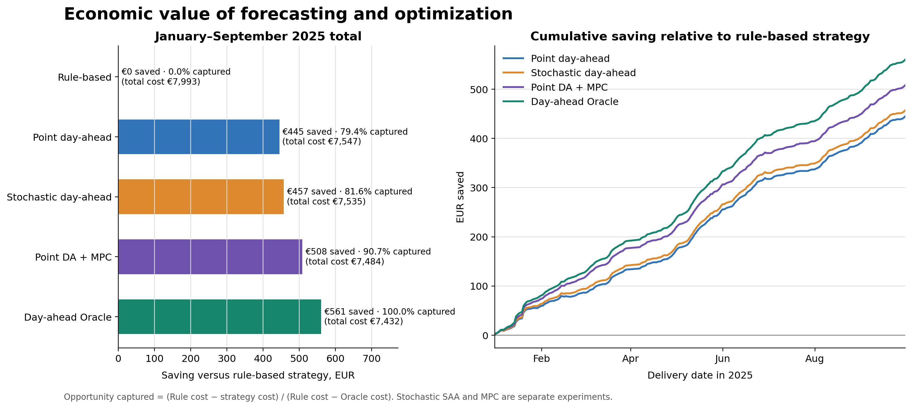
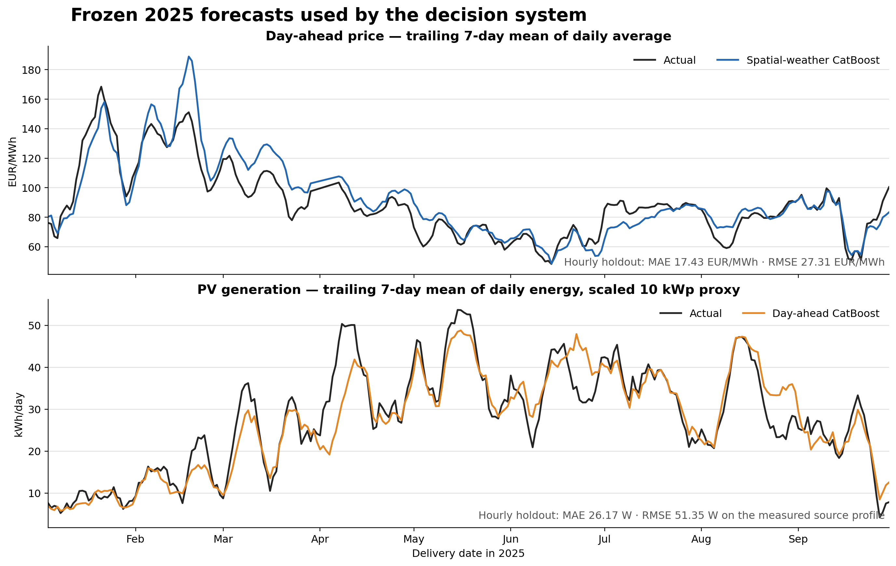

# Forecasting and Optimization for Industrial Energy Management

> Updated 19 November 2026. Forecasting and economic results retain the frozen
> 2024-to-2025 evaluation contract. Section 7 documents the deployed
> historical-stream ML service, dashboard and verified GitLab CI/CD workflow.
> The service simulates industrial operation; it does not control a real plant
> or submit electricity-market orders.

## Executive summary

This project develops a small but complete decision system for an industrial
electricity consumer with flexible production load, on-site photovoltaic
generation and battery storage. The system must decide how to distribute
200 kWh of daily production over a 06:00--22:00 operating window, how to use a
44.16 kWh battery, how much electricity to nominate in the German day-ahead
market, and how to revise the physical schedule as new information becomes
available during the day.

The technical core combines point and probabilistic forecasting,
mixed-integer optimization, receding-horizon model-predictive control and
scenario-based stochastic optimization. The forecasting experiments include
gradient-boosted trees, persistence and autoregressive baselines, direct
residual correction, and MIMO models based on multilayer perceptrons and
LSTMs. Uncertainty is represented through joint residual bootstrap,
multi-quantile regression, empirical copulas and conformal calibration. The
decision experiments compare deterministic mixed-integer programming, sample
average approximation and mean-CVaR optimization. This breadth is deliberate:
the project tests an integrated decision workflow and the practical value of
advanced methods, rather than a single isolated model.

All model and policy choices are developed on 2024 data and then frozen. The
final evaluation uses 261 complete delivery days from January through
September 2025. Forecast metrics are reported as diagnostics, while the main
criterion is realised economic cost. Every policy is executed and settled
against the same factual PV generation, day-ahead prices, intraday-price proxy,
grid tariffs and battery-cost assumptions.

Two reference policies frame the economic comparison. The **Rule-based
strategy** is a performance floor: a common-sense schedule derived from
observed market dynamics, placing flexible load in historically cheaper hours
and battery discharge in historically expensive hours. It requires no machine
learning or mathematical optimization and could be implemented in a
spreadsheet. The **Day-ahead Oracle** is the performance ceiling and cost lower
benchmark for the non-speculative day-ahead planning problem. It allocates
load, PV and battery capacity using factual PV generation and factual
day-ahead prices that would not be known when a real nomination is submitted.
It does not know future intraday prices and is prevented from speculative
intraday trading, so its advantage comes only from perfect day-ahead
information. It is therefore not a guaranteed pathwise cost minimum once
forecast-driven policies are settled against realised intraday prices.

The resulting costs and the share of the Rule-to-Oracle opportunity captured
by each evaluated strategy are presented below.

| Strategy | Jan--Sep 2025 cost | Saving vs Rule | Opportunity captured |
|---|---:|---:|---:|
| Rule-based | EUR 7,992.53 | -- | 0.0% |
| Point day-ahead | EUR 7,547.38 | EUR 445.15 | 79.4% |
| Stochastic day-ahead, raw residual SAA | EUR 7,535.12 | EUR 457.41 | 81.6% |
| Point day-ahead + MPC | **EUR 7,484.07** | **EUR 508.46** | **90.7%** |
| Day-ahead Oracle | EUR 7,431.97 | EUR 560.56 | 100.0% |

**Figure 1.** Economic value relative to the common Rule-based policy. The
stochastic day-ahead and deterministic MPC results are separate experiments;
their gains must not be added.

The result should be read as evidence about the architecture and the relative
value of its components, rather than as a commercial savings claim. Access to
data was limited to public measurements, archived weather forecasts,
reanalysis and public market indices. The project has no on-site weather
station, plant telemetry, executable intraday quotes or order-book data. The
PV plant, battery and industrial demand form a synthetic scenario around a
real measured PV shape, and the economic replay covers nine months. Developing
state-of-the-art standalone forecasting models was therefore not the primary
goal: the models were kept deliberately compact so that the full path from
historical data to forecast, constrained decision and realised settlement
could be evaluated consistently.

## Motivation

The project began as a personal applied-research exercise: to combine data
science, forecasting, optimization and MLOps around one energy-management
problem. A parallel goal was to understand the structure of the German
electricity market and to represent its relevant operational and settlement
rules explicitly in the decision model.

The objective was not to reproduce a commercial energy-management platform or
to imply that a public-data simulation can determine an investment case. The
objective was to formulate the information boundary carefully, build the
decision chain end to end, compare strategies of increasing sophistication,
and identify where added complexity creates measurable value.

## 1. Business setting and decision chronology

The model represents an industrial prosumer in the DE-LU market area. The
production process requires 200 kWh during local hours 06:00--21:00. Each hour
must consume between 5 and 20 kWh, but the exact profile is flexible. A 10 kWp
PV proxy and two reference battery units can offset grid purchases or export
energy.

The decision process has two layers.

### Day-ahead decision

Before delivery, the system receives archived weather forecasts, historical
prices, the initial battery state and the production requirement. It predicts
PV generation and the next day's day-ahead price curve, then jointly selects:

- the hourly production-load profile;
- battery charge, discharge and state of charge;
- PV curtailment;
- the signed day-ahead market position.

The resulting position is fixed after the auction.

### Intraday MPC

Immediately before 06:00 and then once per hour, the controller observes the
executed load, battery state and completed PV and intraday-price observations.
It updates the PV and price forecasts, solves the remaining-horizon problem,
executes only the next action, and repeats. Past actions and the day-ahead
position cannot be changed.

The realised difference between physical grid exchange and the fixed
day-ahead position is settled at an hourly intraday continuous-price proxy.
Grid charges are applied to physical import, rather than to the financial
market deviation.

## 2. Data and reference scenario

The project combines measured, public and synthetic inputs.

| Component | Source and role | Main limitation |
|---|---|---|
| PV output | KIT MPVBench profile `1a`, 15-minute measurements, aggregated hourly | Exact panel coordinates and timestamp convention are not published |
| Weather fact | ERA5 reanalysis near Pforzheim, approximately 48.89 N, 8.70 E | Grid-cell reanalysis, not an on-site sensor |
| Weather forecasts | Archived DWD ICON forecasts; ten German locations for the price model | Fixed historical forecast products do not reproduce a live vendor feed exactly |
| Day-ahead prices | Public DE-LU auction history | Hourly products end after September 2025 in the working data contract |
| Intraday prices | Energy-Charts Intraday Continuous Average Price | Delivery-period average, not an executable quote or order book |
| Production load | Synthetic flexible demand | No real plant process or ramp constraints |
| Battery and tariff | Reference equipment and Pforzheim 2025 variable tariff | Engineering and contract assumptions, not site telemetry or an offered supply contract |

The common UTC intersection of actual weather, archived weather forecasts and
day-ahead prices covers 17,543 hourly timestamps in 2024--2025. MPVBench
contains 70,176 fifteen-minute records across five profiles. Profile `1a` is
used because it has the cleanest coverage; three dates with simultaneous zero
production across several profiles are treated as data outages.

The PV series provides a real production *shape*. It is scaled by a factor of
20 from the roughly 0.5 kW source profile to a 10 kWp modelling asset. The
working timezone assumption is `Europe/Berlin`, supported by the observed
solar-day alignment but not confirmed by source metadata.

The fixed physical scenario is:

| Parameter | Value |
|---|---:|
| Daily production energy | 200 kWh |
| Operating window | 06:00--22:00, 16 delivery hours |
| Hourly production bounds | 5--20 kWh |
| PV proxy | 10 kWp |
| Battery usable capacity and initial SoC | 44.16 kWh |
| Maximum charge and discharge | 5 kWh per hour |
| Charge/discharge efficiency | 98% / 98% |
| Degradation cost | EUR 0.05 per discharged kWh |
| Daytime variable import tariff | EUR 0.10181 per kWh |
| Nighttime variable import tariff | EUR 0.07441 per kWh |

Fixed daily network charges are excluded from dispatch and pairwise strategy
comparisons because they are identical for every policy. They can be added to
an absolute customer bill without changing any decision or relative saving.

## 3. Mathematical decision model

### 3.1 Notation

Let the operating hours be

$$
\mathcal H=\{6,7,\ldots,21\}.
$$

For hour \(h\), let \(L_h\) be production consumption, \(G_h\) available PV,
\(U_h\) curtailed PV, \(C_h\) battery charge, \(D_h\) battery discharge and
\(E_h\) state of charge. The signed physical grid exchange is

$$
g_h=L_h+C_h-(G_h-U_h)-D_h.
$$

Positive \(g_h\) is import and negative \(g_h\) is export. Its linear split is

$$
I_h\ge g_h,\qquad I_h\ge0,
$$

$$
X_h\ge-g_h,\qquad X_h\ge0.
$$

Here \(q_h^{DA}\) is the signed day-ahead nomination and

$$
\Delta_h=g_h-q_h^{DA}
$$

is the realised intraday deviation.

### 3.2 Flexible production load

The process must complete its daily energy requirement while respecting hourly
bounds:

$$
\sum_{h\in\mathcal H}L_h=200,
$$

$$
5\le L_h\le20\qquad\forall h\in\mathcal H.
$$

This is intentionally an energy-allocation model. Start-up costs, product
deadlines, ramping and machine-level constraints are outside the V1 scope.

### 3.3 PV and curtailment

PV may be consumed, stored, exported or curtailed:

$$
0\le U_h\le G_h.
$$

Curtailment prevents the optimizer from treating export during sufficiently
negative prices as mandatory. In execution, the optimized curtailment fraction
is applied to factual PV so that forecast error cannot create infeasible
negative generation.

### 3.4 Battery dynamics

For charge efficiency \(\eta_c\) and discharge efficiency \(\eta_d\),

$$
E_{h+1}=E_h+\eta_c C_h-\frac{D_h}{\eta_d},
$$

$$
0\le E_h\le E^{\max},\qquad E^{\max}=44.16.
$$

Charge and discharge are capped at 5 kWh per hour. A binary operating mode
prevents simultaneous charging and discharging:

$$
0\le C_h\le5z_h,
$$

$$
0\le D_h\le5(1-z_h),\qquad z_h\in\{0,1\}.
$$

The model can charge during the working day when wholesale price, grid tariff,
PV opportunity cost and terminal battery value make it economic. This includes
negative-price periods and low-price PV surplus.

Overnight charging is not represented as a separate hourly optimization
problem. Instead, each operating day starts with a full battery, and any
closing SoC shortfall is converted into a terminal recharge liability using a
causal proxy for the expected overnight charging price:

$$
C_T=\frac{E^{\max}-E_T}{\eta_c}
\left(\frac{\max(\bar P^{night},0)}{1000}+t^{night}\right).
$$

The causal night-price benchmark \(\bar P^{night}\) is the rolling mean of the
latest 14 completed nights. Each night covers price labels 22:00, 23:00 and
00:00--06:00. Negative nightly means are floored at zero before aggregation.

### 3.5 Settlement ledger

Let \(P_h^{DA}\) and \(P_h^{ID}\) be realised prices in EUR/MWh, \(t_h^{imp}\)
the variable physical-import tariff, \(t^{exp}\) the export charge and
\(c^{deg}\) battery degradation cost. Realised daily cost is

$$
\begin{aligned}
C_{day}={}&
\sum_h\frac{P_h^{DA}}{1000}q_h^{DA}
+\sum_h\frac{P_h^{ID}}{1000}\Delta_h\\
&+\sum_h t_h^{imp}I_h
+\sum_h t^{exp}X_h
+c^{deg}\sum_hD_h
+C_T.
\end{aligned}
$$

The ledger separates the financial market position from physical grid use.
This avoids charging network fees on a purely financial deviation and supports
exact reconciliation of every strategy.

### 3.6 Deterministic day-ahead optimization

The deterministic optimizer replaces future PV and prices by point forecasts
\(\widehat G_h\) and \(\widehat P_h^{DA}\), solves the physical schedule and
sets

$$
q_h^{DA}=L_h+C_h-(\widehat G_h-U_h)-D_h.
$$

The decision variables are the hourly load, charge, discharge, curtailment,
SoC, battery mode and physical import/export variables. The optimizer minimizes
forecasted day-ahead energy cost, physical grid charges, battery degradation
and terminal recharge liability:

$$
\min_{L,C,D,U,E,z,I,X}
\left[
\sum_{h\in\mathcal H}
\left(
\frac{\widehat P_h^{DA}}{1000}q_h^{DA}
+t_h^{imp}I_h+t^{exp}X_h+c^{deg}D_h
\right)
+C_T
\right].
$$

The binary battery-mode variable \(z_h\) makes this a mixed-integer linear
program rather than a continuous linear program. It is required to enforce the
discrete choice between charging and discharging in each hour.

The schedule is therefore balanced under the information available before the
auction. Forecast error creates a deviation only when the day is executed.

### 3.7 Shrinking-horizon MPC

At decision time \(\tau\), all actions before \(\tau\), current SoC and the
completed portion of the 200 kWh requirement are fixed. The controller solves
the same model over

$$
\mathcal H_\tau=\{\tau,\tau+1,\ldots,21\},
$$

subject to the remaining-load constraint

$$
\sum_{h\in\mathcal H_\tau}L_h
=200-\sum_{h<\tau}L_h^{actual}.
$$

The day-ahead position \(q_h^{DA}\) remains fixed. Load, charge, discharge,
curtailment and SoC are reoptimized. Only the first action is executed before
the horizon shrinks and the problem is solved again.

At time \(\tau\), the MPC decision variables are the same physical variables
as in the day-ahead problem, restricted to the remaining horizon. The incurred
day-ahead purchase is already fixed and is therefore a constant in this
optimization. MPC minimizes the forecasted cost of the remaining intraday
deviations, physical grid use, battery degradation and terminal recharge:

$$
\min_{L,C,D,U,E,z,I,X}
\left[
\sum_{h\in\mathcal H_\tau}
\left(
\frac{\widehat P_{h\mid\tau}^{ID}}{1000}
\left(g_{h\mid\tau}-q_h^{DA}\right)
+t_h^{imp}I_h+t^{exp}X_h+c^{deg}D_h
\right)
+C_T
\right].
$$

The next-hour intraday-price forecast uses the learned spread correction; more
distant hours retain the known day-ahead curve. The forecast grid exchange
\(g_{h\mid\tau}\) uses the latest PV forecast and current factual battery
state.

### 3.8 Stochastic day-ahead optimization

The stochastic extension generates \(S=500\) joint daily scenarios for PV,
day-ahead price and the intraday-minus-day-ahead spread. Two scenario-generation
approaches were implemented and compared.

The intraday spread is needed even though the decision is made day-ahead.
Errors in the PV forecast cause the realised physical exchange to differ from
the submitted day-ahead position, and that deviation is settled at the future
intraday price,

$$
P_{s,h}^{ID}=P_{s,h}^{DA}+S_{s,h}.
$$

The spread scenarios therefore value forecast-induced imbalance risk; they do
not permit the optimizer to take a speculative intraday position. If the model
instead assumed \(P_h^{ID}=P_h^{DA}\) in every scenario, a separate spread
forecast would not be required.

1. **Joint residual bootstrap.** Rolling-origin 2024 forecast errors are stored
   as complete daily trajectories. One sampled historical day supplies the PV,
   day-ahead-price and spread residual paths together, preserving cross-hour
   and cross-target dependence. Raw, centered and seasonally weighted variants
   were evaluated.
2. **Multi-quantile regression with an empirical copula.** Separate conditional
   quantile models estimate the marginal predictive distributions. Historical
   rank vectors form an empirical copula that reconnects the marginals into
   coherent multivariate daily scenarios. Conformal calibration was evaluated
   as an additional coverage correction.

Both generators feed the same stochastic optimizer, which separates the value
of scenario construction from the value of the optimization formulation.

The physical decisions are shared across scenarios. To prevent deliberate
day-ahead/intraday speculation, the nomination remains tied to the frozen
point PV forecast. Scenario uncertainty changes the settlement deviation, not
the commercial interpretation of the nomination.

Sample-average approximation solves

$$
\min_x\frac{1}{S}\sum_{s=1}^{S}C_s(x).
$$

The risk-averse extension adds empirical CVaR:

$$
\min_{x,\zeta,\xi_s}
\left[
\frac{1}{S}\sum_sC_s(x)
+\lambda\left(
\zeta+\frac{1}{(1-\alpha)S}\sum_s\xi_s
\right)
\right],
$$

subject to

$$
\xi_s\ge C_s(x)-\zeta,\qquad \xi_s\ge0,
$$

with \(\alpha=0.95\). Stochastic MPC is deliberately excluded: it would require
hundreds of scenario optimizations at every hourly control step, while the
deterministic MPC already leaves a small residual opportunity.

### 3.9 Rule-based and Oracle boundaries

The Rule-based policy uses an average historical price shape to place high
load in cheap hours and battery discharge in expensive hours. Its day-ahead
purchase covers the production profile. Factual PV can refill battery headroom,
serve load or be exported; residual PV is curtailed under negative prices.

The Oracle knows factual PV and factual day-ahead prices before nomination. It
does not know or trade against future intraday prices. Its nomination equals
its physical schedule,

$$
q_h^{DA}=g_h,
$$

so \(\Delta_h=0\). This defines a lower benchmark within the honest,
non-speculative day-ahead scheduling class without giving the Oracle an
artificial trading advantage. It is not a universal pathwise lower bound for
the realised two-settlement ledger. A forecast-driven policy can occasionally
finish below the Oracle by chance when its unplanned PV, load or battery
deviation is settled at a favourable intraday price. That outcome is lucky
settlement, not superior information or a reproducible speculative strategy.

## 4. Forecasting and uncertainty models

The point models are deliberately compact. The project aims to test an entire
decision system, rather than to win a forecasting benchmark through extensive
model search.

| Decision input | Final point model | Frozen 2025 result |
|---|---|---:|
| Day-ahead PV | CatBoost with calendar, solar geometry and archived weather | MAE 26.17 W, RMSE 51.35 W; nMAE 5.32% of 2024 observed peak |
| Intraday PV | Direct CatBoost residual correction | MAE 16.41 W vs 17.44 W frozen-head baseline on MPC pairs |
| Day-ahead price | CatBoost with price history, calendar and spatial German weather | MAE 17.43 EUR/MWh, RMSE 27.31 EUR/MWh, daily Spearman 0.912 |
| Intraday price | Regularized CatBoost on intraday-minus-day-ahead spread, shrunk 70% for the next hour | All-horizon MAE 12.65 vs 12.78 EUR/MWh for the known day-ahead curve |

**Figure 2.** Frozen forecasts against 2025 facts. The lines are trailing
seven-day summaries for readability; reported metrics are calculated on
hourly observations.

### 4.1 PV model comparison

The intraday PV experiment compares a frozen day-ahead forecast, latest-error
persistence, direct CatBoost residual correction, a MIMO multilayer perceptron
and a MIMO LSTM. Every model is evaluated on the same 17,034
`(decision time, future target hour)` pairs.

| Intraday PV method | MAE, W | RMSE, W | MAE change vs frozen day-ahead |
|---|---:|---:|---:|
| Frozen day-ahead forecast | 17.44 | 33.15 | -- |
| Latest-residual persistence | 44.65 | 68.59 | 156.0% worse |
| Direct residual CatBoost | **16.41** | **31.70** | **5.9% better** |
| MIMO MLP | 17.28 | 33.11 | 0.9% better |
| MIMO LSTM | 17.08 | 33.73 | 2.1% better |

The difference between CatBoost and the neural trajectory models is modest,
but CatBoost is both the most accurate and the simplest model to train, serve
and explain. More data-intensive sequence architectures, including temporal
transformers such as TFT, Informer or PatchTST, were considered but not pursued.
With only one year of single-site training history, a reliable comparison would
be difficult and added model capacity would be more likely to increase
variance than to improve the decision system.

### 4.2 Price model comparison

The day-ahead price experiment moves from a simple previous-day persistence
baseline to price-history CatBoost, then adds local and spatial weather
forecasts.

| Day-ahead price method | MAE, EUR/MWh | RMSE, EUR/MWh | Mean daily Spearman |
|---|---:|---:|---:|
| Previous-day same-hour persistence | 25.57 | 40.12 | 0.796 |
| Price history + calendar | 20.36 | 30.95 | 0.876 |
| Price history + local weather | 19.33 | 30.06 | 0.878 |
| Price history + spatial German weather | **17.43** | **27.31** | **0.912** |

For intraday prices, the already-cleared day-ahead curve remains the strongest
baseline. The tested alternatives include last-price persistence, direct
CatBoost prediction of the intraday-minus-day-ahead spread, richer rolling
statistics, a local AR(1) feature, and updated local and spatial weather. The
selected hybrid applies a shrunk CatBoost spread correction only to the next
delivery hour and retains the day-ahead curve beyond it. The full-horizon MAE
improves only from approximately 12.8 to 12.6 EUR/MWh; applying the correction
to every remaining hour is worse. The final design therefore keeps the small,
stable correction rather than the most elaborate feature set.

![Intraday continuous-average prices against the two causal forecast alternatives. The upper panel shows the next-hour MPC forecast used by the economic replay: the known auction-cleared day-ahead curve plus 70% of the CatBoost spread correction. The lower panel deliberately uses the harder pre-auction day-ahead model forecast. Both panels show trailing seven-day means of daily averages over operating hours 06:00--21:00; metrics use the same 4,176 hourly observations from 261 delivery days. MAE is 11.67 EUR/MWh for the intraday model, 13.46 EUR/MWh for the known day-ahead curve and 23.88 EUR/MWh for the pre-auction day-ahead model. The known clearing curve is the operational MPC baseline.](assets/report/intraday_price_forecast_comparison_2025.png)

\clearpage

### 4.3 Probabilistic forecasting and scenario generation

The project evaluates conditional quantile regression and residual-based
scenario generation, rather than treating uncertainty as a fixed Gaussian
error around the point forecast.

| Approach | Construction | Observed role in the project |
|---|---|---|
| MultiQuantile CatBoost | Jointly estimates nine conditional quantiles from P05 to P95 for every target and hour | Flexible marginal distributions, but raw price and spread intervals are underdispersed |
| Empirical copula | Samples historical 48-dimensional rank vectors covering PV generation, day-ahead price and the intraday-minus-day-ahead price spread over sixteen hours | Restores cross-hour and cross-target dependence to separately estimated marginals |
| Conformalized quantile regression | Expands quantile intervals using rolling-origin 2024 nonconformity scores | Repairs coverage, but produces conservative intervals and no superior economic policy |
| Joint residual bootstrap | Samples complete rolling-origin daily residual trajectories for PV, day-ahead price and spread | Simpler dependence model and the best realised stochastic economic result |
| Seasonal residual bootstrap | Reweights residual days by circular calendar distance and rescales PV errors locally | Useful conditional sensitivity check, without a material economic gain |

For the raw quantile model, P10--P90 coverage is 72.7% for PV, 41.2% for
day-ahead price and 55.0% for intraday spread, compared with a nominal 80%.
Conformal calibration raises those values to 90.9%, 87.1% and 87.7%,
respectively. It solves undercoverage but overshoots the target and widens the
market-price intervals substantially. The empirical-copula workflow is
therefore technically valid and demonstrates conditional probabilistic
forecasting, but its scenarios do not outperform the simpler residual
bootstrap in the final economic replay.

The seasonal bootstrap was introduced to avoid drawing a winter residual day
for a summer forecast with the same probability as a nearby calendar day. For
target date \(d\), historical residual day \(j\) receives weight

$$
w_j(d)=(1-\rho)
\frac{\exp\left[-\Delta_{circ}(d,j)^2/(2b^2)\right]}
{\sum_k\exp\left[-\Delta_{circ}(d,k)^2/(2b^2)\right]}
+\rho\frac{1}{N},
$$

where \(\Delta_{circ}\) is circular day-of-year distance, \(b=25\) days and
\(\rho=0.15\). The 15% uniform mixture prevents rare residual regimes from
disappearing completely. One selected day still supplies the complete paired
PV, day-ahead-price and spread trajectory. PV residuals are standardized by
local hour-specific scale before being mapped to the target day's forecast
scale.

This conditioning reduces the mean effective residual library from 210 to
64.8 days. It brings day-ahead-price P10--P90 coverage to 80.4%, but does not
improve PV CRPS and worsens spread CRPS. Seasonal SAA saves EUR 8.81 relative
to deterministic day-ahead, compared with EUR 12.26 for raw uniform residual
SAA. On the May--September period with adequate seasonal support, seasonal and
centered uniform sampling save EUR 3.76 and EUR 3.74 respectively. The seasonal
kernel is therefore retained as a robustness check, not as the selected
scenario generator.

## 5. Evaluation design

The evaluation follows a strict temporal contract:

- all model development and fitting use 2024 data;
- fixed configurations are refitted on all eligible 2024 observations;
- January--September 2025 is read once as a future holdout;
- no 2025 target is used in feature scaling, model selection or scenario
  construction;
- rolling-origin predictions create the 2024 residual library used by the
  stochastic generator;
- all economic policies use the same 261 complete delivery days and the same
  factual settlement ledger.

The price evaluation ends on 30 September because the working day-ahead source
changes from hourly to 15-minute products on 1 October 2025. Quarter-hour
prices are not averaged into a synthetic hourly contract.

Forecast metrics are supporting diagnostics. The primary selection criterion
is realised out-of-sample economic cost. Economic differences for stochastic
policies are accompanied by moving-block bootstrap intervals, preserving some
serial dependence between neighbouring delivery days.

Repeated experiments against the same 2025 period create a real risk of
researcher overfitting. Results are therefore interpreted as project evidence,
not as a final unbiased estimate for a commercial deployment.

## 6. Economic results and interpretation

### 6.1 Deterministic decision stack

Point day-ahead optimization saves EUR 445.15 relative to Rule-based and leaves
EUR 115.41 of the Rule-to-Oracle opportunity unresolved. MPC adds EUR 63.31,
closing 54.9% of that remaining gap. The combined deterministic system ends
only EUR 52.10 above Oracle.

This is a stronger result than the forecast metrics alone suggest. The direct
PV residual correction improves trajectory MAE by only 5.9%, and the
next-hour intraday-price correction is also small. MPC still creates material
value because it repeatedly reallocates the remaining production requirement
and battery energy after forecast errors have become observable.

![Temporal decomposition of the deterministic economic result over all 261 delivery days. The upper panel is day-ahead-only cost minus Day-ahead Oracle cost; the lower panel is deterministic MPC cost minus day-ahead-only cost. Thin lines are unsmoothed daily values and bold lines are trailing 14-delivery-day means in EUR/day. Both panels use the same symmetric scale and an emphasized zero; the lightly shaded positive half of the lower panel is the MPC loss zone. Full-period totals are EUR 115.41 of day-ahead gap to Oracle and EUR -63.31 of incremental MPC cost effect.](assets/report/day_ahead_gap_and_mpc_effect_2025.png)

The April break is not a deterioration of the intraday-price model: next-hour
MAE improves from 12.05 to 11.32 EUR/MWh. The upstream change is larger:
day-ahead-price MAE drops from 27.53 to 17.41 EUR/MWh, the daily
Day-ahead-to-Oracle gap drops from EUR 0.658 to EUR 0.332, and the MPC effect
drops from EUR 0.491 to EUR 0.116 per day. In January--March MPC intraday
settlement is EUR 7.84 worse than Day Ahead, while battery and terminal-recharge
cost is EUR 87.78 lower, partly offset by EUR 36.72 of additional regulated
import cost. Early MPC value therefore mainly corrects battery actions induced
by weak pre-auction forecasts, not next-hour price trading. The result uses the
hourly intraday continuous-average proxy, not a true imbalance price or
quarter-hourly execution.

This also explains why the thin daily Day-ahead-to-Oracle line occasionally
crosses below zero. The Oracle deliberately has zero intraday deviation and
does not know future intraday prices, whereas a forecast-based policy can make
an accidental deviation that later receives a favourable realised settlement
price. The comparison does not allow either policy to create deviations for
the purpose of price speculation; it measures operational forecast error and
replanning under the same physical ledger.

### 6.2 Stochastic day-ahead optimization

Raw joint-residual SAA costs EUR 7,535.12 and saves EUR 12.26 relative to the
point day-ahead policy. Its 95% moving-block bootstrap interval is
[EUR 6.12, EUR 19.47], so the mean-cost improvement is supported within this
replay. It closes 10.6% of the remaining Point-to-Oracle gap.

The gain is useful but modest. Centering residuals reduces the saving to
EUR 10.71. A seasonal conditional bootstrap saves EUR 8.81 over the full
period and is nearly indistinguishable from centered uniform sampling on the
seasonally well-supported May--September subset.

Adding CVaR penalties does not establish a reliable reduction in realised
CVaR95. Large weights make the schedule more conservative and increase total
cost. The selected stochastic strategy is therefore risk-neutral SAA rather
than a mean-CVaR policy.

### 6.3 Physical audit

Every final strategy satisfies the same physical checks:

- exactly 200 kWh of production is completed on every retained day;
- SoC stays inside 0--44.16 kWh;
- charge and discharge never overlap;
- curtailment remains between zero and factual PV;
- the Oracle has zero intraday deviation;
- hourly energy balance and daily cost components reconcile numerically.

Battery use changes materially with policy. Rule-based performs 49.4 equivalent
full cycles over the replay, point day-ahead 142.4, deterministic MPC 136.8
and Oracle 144.2. Degradation and overnight restoration are included, so the
optimizer does not treat battery energy as free.

## 7. Deployed ML service and operating model

The modelling and optimization code is deployed as a working ML service on one
Ubuntu 24.04 x86-64 VM in Yandex Cloud. The public
[operations dashboard](http://81.26.188.18:8080) and the
[GitLab project](https://gitlab.com/olip78/energy-optimization) demonstrate the
complete path from historical inputs to forecasts, decisions, monitoring and
application deployment. The first end-to-end GitLab deployment was verified on
19 November 2026.

The code remains a modular Python package: data contracts, feature builders,
training applications, optimizers and replay share units and temporal
conventions. Python, CatBoost, pandas/NumPy and SciPy/HiGHS provide forecasting
and deterministic MILP/MPC. FastAPI/Uvicorn exposes the service; the frontend
uses HTML, CSS, JavaScript and SVG. Docker Compose, Nginx, SQLite, MLflow,
GitLab CI/CD, Container Registry and systemd provide the small service platform.

### 7.1 Historical-stream operation in real time

The service computes fresh model predictions and optimization decisions rather
than serving saved economic decisions. Four CatBoost estimators form an
immutable, checksummed release: day-ahead PV, day-ahead price, MPC PV residual
correction and intraday price spread. Initial service models use 2024 history,
with the latest 28 days held out for validation and not refitted. This serving
configuration is versioned separately from the frozen research experiments;
the economic results reported earlier are not measurements of the live demo.

March--June 2025 is replayed once to build genuine pseudo-history for monitoring
and candidate training. The prepared snapshot contains 111 complete delivery
days in that interval. July--September supplies a repeating operational loop
of 91 complete days; incomplete source days are quarantined. At the loop
boundary, virtual time and model state return to the saved July checkpoint,
so a new cycle does not inherit training from the previous pass through the
same three months.

One real Berlin operating day maps to one complete historical delivery day.
The worker checks the clock every 30 seconds and reveals only completed hourly
intervals: at 07:00, the 06:00--07:00 action is committed. After the final
interval completes at 22:00, the full day remains visible overnight. At 06:00
the next historical day opens. The Europe/Berlin zone handles daylight-saving
changes; a persistent real-date anchor allows sequential catch-up after a
restart. Catch-up and retraining can temporarily delay progression.

Historical forecast features and observations are gated by their recorded
availability times. Tomorrow's day-ahead plan is withheld until its inputs
are available, normally 11:00 in simulation time. The active model release
produces forecasts, the deterministic optimizer builds the day-ahead plan,
and MPC commits only its first action before recalculating the remaining
horizon at the next completed operating hour. The dashboard labels real
Berlin time separately from the historical simulation time and last settled
interval. Public visitors cannot change the clock or reset the shared replay.

### 7.2 Single-VM architecture

Docker Compose runs the following components on one local host:

| Component | Responsibility |
|---|---|
| Nginx | Public read-only dashboard/API proxy on port 8080; routes to the active API slot |
| FastAPI blue/green slots | Serve forecasts, decisions and monitoring; readiness verifies inputs and active model artifacts |
| One replay/training worker | Advance the Berlin-clock replay, execute MPC and schedule biweekly candidate jobs |
| MLflow | Private experiment tracking, four-model registration and model provenance |
| Mounted runtime directory | Historical snapshots, immutable releases, SQLite state and monitoring history |
| systemd maintenance timer | Daily SQLite compaction and old unused Docker image/build-cache cleanup |

Nginx switches between API slots during application deployment. The worker is
updated separately and remains a single writer. A single-host lock serializes
state-changing operations; state advances and their audit records commit in
one SQLite transaction. SQLite WAL and model manifests live on the VM's local
disk. The public service uses HTTP on the VM IP; MLflow remains bound to
loopback/internal networking and administrative routes are blocked at the
public proxy. Credentials and runtime data are excluded from the repository
and application image.

This implementation uses Docker Compose and systemd. Kubernetes/k3s, ClearML,
a distributed data platform and separate monitoring servers are not required
for the deployed demo. Application blue/green deployment is distinct from
promotion or rollback of a compatible model release.

### 7.3 Model lifecycle and monitoring

Every fourteen virtual calendar days, the worker runs an idempotent candidate
training job on newly available local historical data and logs the resulting
four-model release to MLflow. Candidate validation compares forecast MAE with
the current champion on the same held-out window; a three-day economic replay
adds a smoke gate. The latter is a short engineering check, not a statistically
conclusive estimate of economic improvement. Failed candidates leave the
champion running. Promotion and rollback are explicit day-boundary commands;
automatic promotion and continuous online shadow inference are future work.
The worker pauses virtual progression while training runs.

The dashboard has three views:

- **Live Operations:** day-ahead and executed/current MPC load schedules,
  market/grid position, battery and PV plan-versus-fact charts, current action
  and operating economics.
- **Day-Ahead Plan:** tomorrow's production, procurement, PV/price forecasts,
  battery schedule, expected costs and assumptions once forecast inputs arrive.
- **Monitoring:** feature completeness and drift, operational forecast MAE,
  release-validation references, candidate/release history and retrospective
  day-ahead cost gap to Oracle and incremental MPC cost effect.

Data monitoring checks missing and non-finite features, standardized mean
shift relative to release training statistics and all-zero PV days. Model
monitoring uses completed-day forecast MAE and training/validation references.
The immutable historical-file provider has no independently measured live-feed
freshness SLA. Decision economics is settled retrospectively, so Oracle
comparisons are diagnostics unavailable at the original control instant.

Structured JSON logs carry run, decision and release context. Container logs
rotate, the model cache and thread counts are bounded, and retention keeps
chart prehistory, the current and previous cycles and a short diagnostic audit
plus relevant lifecycle events. The enabled systemd timer adds daily database
compaction and unused-image/cache cleanup. Datasets, model checkpoints and
containers are preserved. The MLflow background job executor is disabled;
the ENERGY worker owns training and scheduling.

### 7.4 Verified CI/CD

The [GitLab pipeline](https://gitlab.com/olip78/energy-optimization/-/pipelines)
runs Python tests and Ruff, checks JavaScript syntax, builds an amd64 Docker
image and checks API liveness without private datasets. A successful image is
published to GitLab Container Registry with its commit SHA as the tag.

A manual production job is available on the protected default branch. It uses
a dedicated SSH key, verifies the VM host key, copies application files while
preserving server credentials/runtime/active-slot configuration, and pulls the
SHA-tagged image. It starts the inactive API slot, waits for model-aware
readiness, validates and reloads Nginx, then updates the sole worker. A GitLab
resource group serializes deployments. The VM uses a read-only Registry token.

The first verified pipeline passed Python checks, JavaScript checks, image
build/liveness and production deployment. Nginx switched from blue to green;
the active four-model release, historical snapshot and operational state were
preserved. The previous API slot remains available for application rollback,
and a runtime/configuration backup was taken before this first rollout.
Failed API readiness leaves the old route active; a failed proxy switch
restores the original upstream. This does not imply transactional rollback of
every process: worker-update failures require operator inspection. Schema
migrations remain a separate operation.

The precise operational commands and scope are documented in the
[deployment guide](deployment.md), [GitLab setup](gitlab.md) and
[technical architecture](architecture.md).

## 8. Limitations

The most important limitations are structural:

1. **Synthetic industrial system.** Load flexibility, PV scale and battery
   capacity are scenario assumptions rather than one site's telemetry.
2. **Location uncertainty.** Weather uses an approximate Pforzheim coordinate,
   and the PV timestamp convention remains provisional.
3. **Market proxy.** Intraday continuous average is a settlement proxy, not an
   executable quote available at the control instant.
4. **Simplified production process.** The model has hourly energy bounds but no
   machine states, ramps, batches, labour constraints or product deadlines.
5. **Limited history.** One training year restricts neural models, tail
   estimation and seasonal residual sampling.
6. **Incomplete customer bill.** Variable grid charges are represented, while
   supplier risk premiums, balancing responsibility, demand charges and
   contract-specific fixed fees are outside the optimized ledger.
7. **Single repeatedly inspected holdout.** January--September 2025 is temporal
   out-of-sample data, but it has been used for several project-level
   comparisons.

These limitations do not invalidate the architecture experiment. They limit
the interpretation of the absolute euro values and prevent the result from
being treated as an investment recommendation.

## 9. Conclusion

The project demonstrates an end-to-end forecasting and optimization workflow
in which models are evaluated through the decisions they support. The strongest
result is the deterministic stack: point day-ahead optimization captures most
of the available value, and MPC recovers more than half of the remaining gap.

Probabilistic forecasting and stochastic optimization add a smaller but
measurable mean-cost improvement. Their main contribution is methodological:
they expose uncertainty explicitly, preserve joint temporal dependence and
allow the cost of risk aversion to be tested. The experiments also show when
that sophistication is not useful: CVaR penalties and more elaborate scenario
models do not automatically improve realised economics.

The workflow is also exercised by a deployed historical-stream ML service:
fresh forecasts and MPC follow Berlin operating hours, a public dashboard
exposes operating/monitoring history, and GitLab CI/CD delivers versioned Docker
images through blue/green application rollouts. Further operational work can
extend automated model promotion, external data ingestion and alerting beyond
this deliberately small single-VM demonstration.

## Supporting project documents

- [Frozen 2024-to-2025 forecast evaluation](temporal_backtest_2025.md)
- [Final deterministic economic formulation](economic_backtest_v4_final_formulation.md)
- [Residual-bootstrap stochastic backtest](residual_bootstrap_spread_economic_backtest_v3.md)
- [Technical architecture](architecture.md)
- [Data-quality report](data_quality_report.md)
